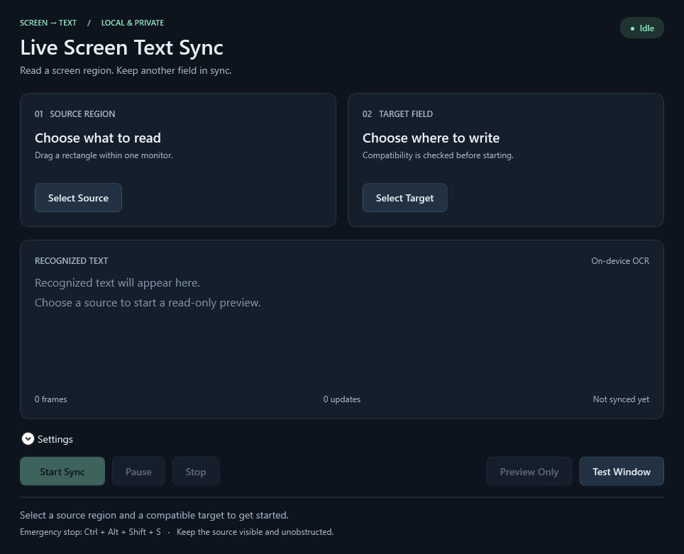

# Live Screen Text Sync

Read text from a visible screen region into the app, then copy it when you need it.

The utility reads text locally into its own window. There is no destination field to select and no compatibility check against another application.



## Quick start

1. Run `LiveScreenTextSync.App.exe` from the extracted portable folder. Keep all extracted files together; .NET is included.
2. Click **Select Source** and drag a rectangle within one monitor. Press **Esc** to cancel.
3. Click **Start Capture**. Recognized text appears in the app's own **Recognized Text** field and updates when the visible source changes.
4. Click **Copy Text** to copy the complete result to the clipboard, or select text in the field and copy it normally.
5. Use **Pause / Resume** or **Stop**. The last captured text remains available to read and copy.

**Sample Text** opens a small test source. Select its `SCREEN TEXT READY` line as your region, start capture, and click **Change Text** to see the app update.

Keep the source visible and unobstructed, and move this app away from the selected region. If another window covers the region, its pixels become the OCR input.

## Settings

- **Interval**: 100–5000 ms, default 200 ms.
- **OCR language**: choose a Windows OCR language installed on the machine.
- **Enhance image for OCR**: extra grayscale, contrast, and dark-background normalization.

Version 0.2.1 automatically enlarges small regions up to 4× and adds background-colored margins before recognition, even when enhancement is off. Bilinear scaling preserves thin character strokes. If the first result is empty, OCR retries once with grayscale/contrast correction. The image-size and memory limits still apply. Select complete letters with a little space around them, and choose the matching OCR language; enlarging cannot restore pixels that were cut off.

The app captures and recognizes asynchronously, discards stale frames, and skips unchanged images. Empty results or OCR errors preserve the last useful text. New nonempty text is displayed immediately; repeated text is not displayed again.

The optional global stop shortcut is **Ctrl + Alt + Shift + S**. If another copy owns it, capture still works and the footer tells you to use the window's **Stop** button.

## Privacy and requirements

OCR runs locally with `Windows.Media.Ocr`; the utility makes no network requests. Screen images and recognized text stay in memory. Only **Copy Text** or your own copy command changes the clipboard. The running capture workflow does not inspect or write to fields in other applications.

Settings and metadata-only rolling logs live in `%LOCALAPPDATA%\LiveScreenTextSync`. Logs exclude recognized text, clipboard contents, and screenshots, and retain up to seven daily files. Source geometry and OCR preferences are saved; captured text is not saved.

The portable build targets x64 Windows 10 version 2004 or later / Windows 11. An installed Windows OCR language is required. Windows OCR worked on the tested machine; availability across other Windows builds depends on the OCR runtime and language features. MSIX packaging is not included.

## Development

Requires the .NET 10 SDK on Windows.

```powershell
dotnet build LiveScreenTextSync.sln
dotnet test LiveScreenTextSync.sln
dotnet run --project src/LiveScreenTextSync.App
```

Run the real local capture checks on an unlocked desktop (the test briefly displays an application-owned sample source):

```powershell
.\scripts\test-windows.ps1
```

Build a portable ZIP:

```powershell
.\scripts\package.ps1 -OutputName LiveScreenTextSync-v0.2.1-win-x64
```

The result is `artifacts/LiveScreenTextSync-v0.2.1-win-x64.zip`. GitHub Actions builds, runs core tests, and publishes a downloadable artifact.

See [architecture](docs/architecture.md) and [validation](docs/validation.md). The former external-target backend remains in source history and diagnostic code; the desktop capture workflow does not use it.
